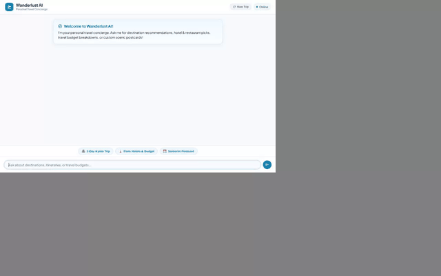

# Wanderlust AI - Personal Travel Concierge

Wanderlust AI is an intelligent travel concierge agent built with the **Google Agent Development Kit (ADK)** and deployed on **Google Cloud Agent Engine**. It assists travelers with personalized destination discovery, itinerary planning, live weather reports, interactive budget calculations, and custom AI-generated postcards and videos.



---

## 🌟 Implemented Features & Services

Based strictly on the codebase in `app/` and `agents-cli-manifest.yaml`, Wanderlust AI incorporates the following Google Cloud and ADK integrations:

- **Vertex AI Memory Bank**: Long-term cross-session memory using `VertexAiMemoryBankService`, `PreloadMemoryTool`, and `generate_memories_callback` to persist traveler preferences, dietary restrictions, and favorite spots.
- **Google Cloud Firestore**: Real-time destination database queries (`search_destinations`, `get_destination_details`, `add_destination`).
- **Google Cloud Storage**: Public media storage for AI-generated assets, returning direct public HTTPS URLs.
- **Vertex AI Image Generation (`gemini-3.1-flash-lite-image`)**: Creates high-quality travel postcards and scenic artwork in the `global` region (`generate_destination_artwork`).
- **Vertex AI Video Generation (`gemini-omni-flash-preview`)**: Generates short destination video clips in the `global` region (`generate_destination_video`).
- **Agent Engine Sandbox Code Executor**: Executes Python code in a secure sandboxed environment for trip calculations (`calculate_trip_budget`).
- **Live Weather API**: Fetches real-time weather forecasts via the Open-Meteo REST API (`get_live_destination_weather`).
- **Geocoding & Attractions**: Performs address geocoding and nearby point-of-interest lookups (`geocode_address`, `find_nearby_places`).
- **A2UI Rich Card Streaming**: Uses `A2uiSchemaManager` and `a2ui_callback` to stream rich visual display cards, image components, and structured layouts.
- **Custom Web Frontend & FastAPI Proxy**: High-performance plain HTML/JS chat frontend with prompt chips, typing indicators, image lightboxes, and session resets.

---

## 🏗️ Architecture

```
                               ┌────────────────────────────────┐
                               │     Custom Web Frontend        │
                               │  (HTML5 / CSS / Vanilla JS)    │
                               └───────────────┬────────────────┘
                                               │ HTTP / A2A
                               ┌───────────────▼────────────────┐
                               │      FastAPI Proxy Server      │
                               │           (main.py)            │
                               └───────────────┬────────────────┘
                                               │ A2A Stream
┌──────────────────────────────────────────────▼──────────────────────────────────────────────┐
│ Wanderlust AI Agent Engine Root Agent                                                       │
├───────────────────┬───────────────────┬───────────────────┬───────────────────┬─────────────┤
│  Memory Bank      │   Firestore DB    │  Cloud Storage    │  Gemini Models    │ Sandbox     │
│  (Session Memory) │   (Destinations)  │  (Media Uploads)  │  (Image / Video)  │ (Code Exec) │
└───────────────────┴───────────────────┴───────────────────┴───────────────────┴─────────────┘
```

---

## 🚀 Local Setup & Running Instructions

### Prerequisites
- **Python 3.11+**
- **uv** package manager (`pip install uv`)
- **Google Cloud SDK** (`gcloud auth login` and `gcloud auth application-default login`)

### 1. Clone & Install Agent Dependencies
Navigate into the agent workspace directory and install python dependencies:

```bash
cd wanderlust-ai
uv sync
```

### 2. Configure Environment Variables
Set your GCP project ID, Cloud Storage bucket, and deployment variables:

```bash
export GOOGLE_CLOUD_PROJECT="<YOUR_GCP_PROJECT_ID>"
export AGENT_ENGINE_RESOURCE_NAME="projects/<PROJECT_NUMBER>/locations/us-east1/reasoningEngines/<ENGINE_ID>"
export AGENT_DIRECTORY="app"
```

### 3. Run Agent CLI Web UI (Local ADK Playground)
Launch the interactive ADK Web Developer Playground:

```bash
uv run adk web app
```

### 4. Run Custom Web Frontend Locally
Navigate into the `frontend/` directory, install frontend dependencies, and launch the proxy server:

```bash
cd frontend
uv sync
uv run python main.py
```

The web application will launch and be accessible in your local browser on port `8080`.

---

## 🛠️ Project Structure

```
wanderlust-ai/
├── app/
│   ├── agent.py               # Root ADK agent configuration, memory service, & tools list
│   ├── tools.py               # Firestore, Cloud Storage, Gemini Image/Video, & Weather tools
│   └── a2ui_utils.py          # A2UI model callback renderer for rich display cards
├── frontend/
│   ├── main.py                # FastAPI proxy server (browser -> FastAPI -> Agent Engine A2A)
│   └── static/
│       └── index.html         # Custom chat frontend UI with A2UI card renderer
├── agents-cli-manifest.yaml   # Agent manifest configuration
├── deployment_metadata.json   # Deployment runtime metadata
├── demo.gif                   # Recorded interactive demo GIF
└── README.md                  # Project documentation
```

---

## 📄 License
Licensed under the Apache License, Version 2.0.
